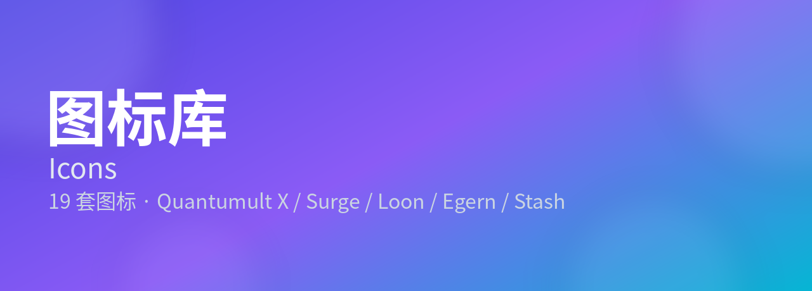

# Scripting 脚本

Scripting App 脚本合集。把喜欢的脚本文件夹下载下来，导入 Scripting App 就能用。
<div align="center">


</div>

## 📊 数据统计

<div align="center">


</div>

## 🛠️ 技术栈

<div align="center">


</div>

## 😄 每日一句

<div align="center">


</div>

## 🎮 贡献图

<div align="center">

<picture>
  <source media="(prefers-color-scheme: dark)" srcset="https://contrib-rotate.lzr52o.workers.dev/rotate?theme=dark" />
  <source media="(prefers-color-scheme: light)" srcset="https://contrib-rotate.lzr52o.workers.dev/rotate?theme=light" />
  
</picture>

</div>


## 脚本列表

| 脚本 | 说明 | 版本 |
|---|---|---|
| [壁纸小组件](scripts/WallpaperWidget) | ACG 二次元壁纸小组件：随机展示高质量 ACG 图片，支持自定义刷新间隔、可指定图片 ID、iOS 小组件显示 | v1.2.1 |

## 壁纸小组件

一个精美的 ACG（动漫）壁纸小组件，让你的 iOS 桌面充满二次元风格。

**主要功能：**

- 随机展示高质量 ACG 图片
- 支持自定义刷新间隔
- 可指定特定图片 ID
- 支持 iOS 小组件显示
- 9 个界面主题（少女粉／清新绿／天空蓝／梦幻紫／活力橙／热情红／薄荷青／阳光黄／彩虹流光），彩虹主题颜色每 1.5 秒流动一次
- iOS 26 液态玻璃界面，背景是跟主题色走的流光渐变

**本版改动（基于原作者 v1.0.3）：**

- 修复图片加载失败：接口返回的死链（404）自动换下一张，最多连试 5 张；主源全挂后走备用直链图源（dmoe.cc、t.mwm.moe），按固定顺序试
- 加载超时 8 秒 → 30 秒，主源失败重试 3 次
- 新增 9 个界面主题与流光渐变背景，设置页改成 iOS 26 原生液态玻璃

原作者：[MolTau9527](https://github.com/MolTau9527)（[Scripting-Tools](https://github.com/MolTau9527/Scripting-Tools)，MIT 协议）

## 安装方法

1. 在 iOS 设备上安装 [Scripting App](https://apps.apple.com/app/id6740200543)
2. 下载对应脚本文件夹（例如 `scripts/WallpaperWidget`）
3. 导入到 Scripting App 中
4. 根据需要配置脚本参数

## 目录结构

```
scripts/
└── WallpaperWidget/          # ACG 壁纸小组件
    ├── script.json           # 脚本配置
    ├── index.tsx             # 主入口
    ├── widget.tsx            # 小组件实现
    └── utils/                # 工具模块
        ├── api.ts            # API 接口
        ├── imageCache.ts     # 图片缓存
        ├── storage.ts        # 存储管理
        ├── theme.ts          # 主题色板
        ├── types.ts          # 类型定义
        ├── utils.ts          # 工具函数
        ├── SettingsPage.tsx  # 设置页面
        └── PreviewHome.tsx   # 预览页面
```

## 说明

- 壁纸小组件基于 MolTau9527 的 v1.0.3 修改，版权归原作者所有；本库仅作修改版收集。
- 图片来源为 ACG 图库（loliapi.com），版权归原作者所有。


