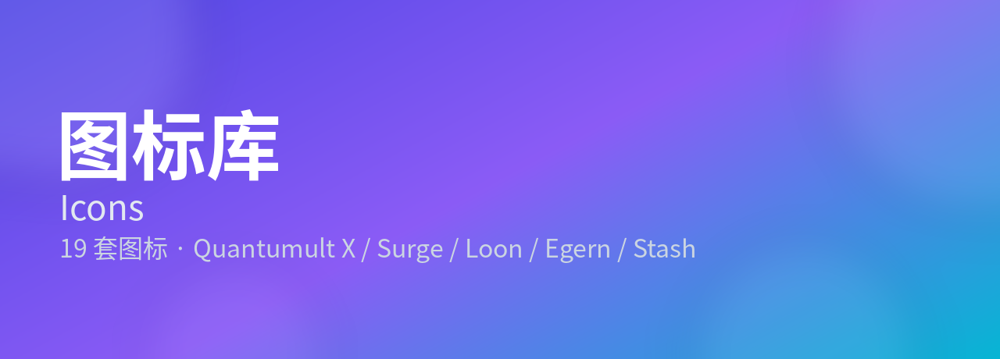

English · [简体中文](README.md) · [日本語](README_JA.md) · [한국어](README_KO.md) · [Türkçe](README_TR.md)



# Scripting Scripts

A collection of scripts for the Scripting App. Download a script folder you like and import it into the Scripting App to use it.
<div align="center">


</div>

## 📊 Statistics

<div align="center">


</div>

## 🛠️ Tech Stack

<div align="center">


</div>

## 😄 Daily Sentence

<div align="center">


</div>

## 🎮 Contribution Graph

<div align="center">

<picture>
  <source media="(prefers-color-scheme: dark)" srcset="https://contrib-rotate.lzr52o.workers.dev/rotate?theme=dark" />
  <source media="(prefers-color-scheme: light)" srcset="https://contrib-rotate.lzr52o.workers.dev/rotate?theme=light" />
  
</picture>

</div>


## 📖 Usage Guide

This is a collection of scripts for the Scripting App: 37 scripts in 8 categories — Wallpaper, Monitoring Tools, Widgets, Daily Check-ins, Productivity, Plugin Store, Tools, and AI. Most of them are home screen widgets that show live info right on your iOS desktop; some are in-app tools (such as GitHub management and icon organizing).

**What you need:**

- An iPhone or iPad with the [Scripting App](https://apps.apple.com/app/id6479691128) installed
- Some scripts need your own account or service to work. For example, qBitHelper connects to your own downloader, SGCC needs your State Grid account, and CF Usage needs your Cloudflare account details — just fill them in when the script asks

**How to use it, step by step:**

1. Pick a script you like from the list above and open its folder
2. Download the whole folder (download the files one by one, or clone / download the whole repo as a ZIP and take out the folder you need)
3. Open the Scripting App and import the downloaded folder
4. To put it on your home screen: long-press an empty spot on the iOS home screen → tap `+` in the top-left corner → find Scripting → pick a widget size → choose the script you just imported
5. Some scripts ask for settings the first time you open them (such as a server address, a city, or an account). Open the script in the Scripting App and fill them in as prompted

> Only AI Usage comes as a `.scripting` package (it contains a lot of images, 19 MB). Download it and import it directly — no need to unzip it.

**FAQ:**

- **The widget doesn't show up after importing?** Open the script in the Scripting App first and check it runs. If it doesn't, the settings are usually missing, or a script that needs the internet couldn't reach the network.
- **Images keep failing to load?** The wallpaper widget loads pictures from online galleries. On a slow connection it takes longer — wait a bit or tap refresh and try again.
- **Only want one script, not the whole repo?** Open the folder you need under `scripts/` and download just that one.
- **Who wrote these scripts?** Except for the wallpaper widget, which is based on the original author's version with modifications, all other scripts are the original authors' versions as-is. Copyright belongs to the original authors; this repo only collects them.

## Script List

### Wallpaper

| Script | Description | Version |
|---|---|---|
| [壁纸小组件](scripts/WallpaperWidget) | ACG anime wallpaper widget: shows high-quality ACG images at random, with a custom refresh interval, a specific image ID option, and iOS widget support | v1.2.6 |

### Monitoring Tools

| Script | Description | Version |
|---|---|---|
| [qBitHelper](scripts/qBitHelper) | Remote monitoring for qBittorrent / Transmission: upload and download speeds, historical data charts, torrent count, in three widget sizes | v1.0.6 |
| [智慧交通](scripts/智慧交通) | City traffic monitor: real-time congestion index, congested road rankings, morning/evening rush-hour forecasts, with support for switching between cities across China | v1.0.0 |
| [Surge Metrics](scripts/Surge%20Metrics) | Surge iOS metrics widget: total traffic, memory, DNS cache, and per-interface traffic rankings | v1.1.1 |
| [流媒體解鎖檢測](scripts/流媒體解鎖檢測) | Streaming unlock checker widget: tests whether your node can access Netflix, Disney+, YouTube, ChatGPT, and more | v1.1.0 |
| [Loon Panel](scripts/Loon%20Panel) | Loon panel widget: proxy traffic, node speed tests, streaming unlock checks — switch nodes and modes right from the home screen | v1.0.9 |

### Widgets

| Script | Description | Version |
|---|---|---|
| [Calendar](scripts/Calendar) | Calendar widget: Gregorian and lunar calendars, holidays, in three sizes | v1.3.0 |
| [Weibo](scripts/Weibo) | Weibo trending searches widget | v1.1.0 |
| [SGCC](scripts/SGCC) | State Grid (网上国网) widget: electricity balance, usage, tier progress, and a usage bar chart | v1.0.1 |
| [App Store Region](scripts/App%20Store%20Region) | App Store region manager widget, in three sizes | v1.0.0 |
| [万年历](scripts/万年历) | Perpetual calendar widget: Gregorian and lunar calendars, holidays, in three sizes | v1.0.0 |
| [Colorful Clouds](scripts/Colorful%20Clouds) | Caiyun weather widget with weather notifications | — |

### Daily Check-in

| Script | Description | Version |
|---|---|---|
| [Live In Earnest](scripts/Live%20In%20Earnest) | Daily check-in, proof that you're still alive | v1.0.0 |
| [Itemory](scripts/Itemory) | Personal item archive: log purchases, repairs, and resale income, calculate days held and daily cost, with receipt screenshot recognition for entry | v1.0.0 |

### Productivity

| Script | Description | Version |
|---|---|---|
| [RSS](scripts/RSS) | RSS reader with AI summaries | v1.0.0 |

### Plugin Store

| Script | Description | Version |
|---|---|---|
| [Scripting Store](scripts/Scripting%20Store) | Scripting plugin store client: browse, search, and install Scripting plugins | v2.0.2 |

### Tools

| Script | Description | Version |
|---|---|---|
| [GitHub Toolkit](scripts/Github%20Toolkit) | All-in-one GitHub tool: browse and edit repos/Gists/Actions, PR diffs, stars, Fork sync | v2.0 |
| [Github Repo](scripts/Github%20Repo) | GitHub repo manager: browse repos, star, sync Forks, create PRs | v3.0 |
| [GitHub Stars](scripts/GitHub%20Stars) | GitHub Stars and repo management: browse by Star date, custom lists, upstream Fork checks, contribution heatmap | v1.1.1 |
| [GitHub 規則添加](scripts/GitHub%20規則添加) | A small tool to quickly add rule files to a GitHub repo | v2.0.0 |
| [Icon Library](scripts/Icon%20Library) | Public GitHub icon library manager: multiple icon libraries, icon import and organization, subscriptions, PNG export | v1.1.2 |
| [IconShelf](scripts/IconShelf) | Icon set subscription manager: icon sets for proxy apps, Emby, and more, with grouping, search, updates, backup and restore | v0.4.0 |
| [Launch](scripts/Launch) | Multi-widget launcher: folder-adaptive, one entry point for multiple widget configs | v1.15.2 |
| [覆写模块聚合](scripts/覆写模块聚合) | Aggregated directory of modules, plugins, and overrides for Surge / Loon / Egern / Stash / Shadowrocket, with search, favorites, and one-tap import | v1.1.0 |
| [CF Usage](scripts/CF%20Usage) | Check Cloudflare account and per-Worker usage, with alerts when nearing the quota | v1.0.0 |
| [GitHub Secrets](scripts/GitHub%20Secrets) | Manage GitHub repo Secrets, with encrypted storage and sharing across repos | v1.0.0 |
| [Storefront](scripts/Storefront) | Manage balances, subscriptions, and TestFlight slots across multiple Apple accounts in different regions | v1.5.0 |
| [Remove Background](scripts/Remove%20Background) | One-tap image background removal | v0.1.0 |
| [Cloudflare Panel](scripts/Cloudflare%20Panel) | Cloudflare panel: account usage and Worker status, with a home screen widget | — |
| [App多区价格查询](scripts/App多区价格查询) | Check an app's price across App Store regions | v1.0.0 |
| [Iconset Helper](scripts/Iconset%20Helper) | Icon set helper: organize and upload icon sets | v1.0.0 |
| [Gist](scripts/Gist) | GitHub Gist manager: create, edit, and view | v1.0.0 |
| [Video to Live Photo](scripts/Video%20to%20Live%20Photo) | Pick a video, a cover frame, and a duration, and save it as a Live Photo | v1.0.0 |
| [Border Beam](scripts/Border%20Beam) | Border glow animation demo (Metal shader), usable as a UI component reference | v1.0.0 |

### AI

| Script | Description | Version |
|---|---|---|
| [AI Usage](scripts/AI%20Usage) | Multi-platform AI usage dashboard: usage across 11 platforms including Codex, Grok, Claude, Cursor, and Kimi, with multiple accounts and a home screen widget | v1.9.0 |
| [寒霜注入工具 2](scripts/寒霜注入工具%202) | Local AI proxy gateway: native iOS TCP true streaming, background keep-alive, multi-engine failover | v1.2.4 |
| [Codex Panel](scripts/Codex%20Panel) | Codex usage panel widget | — |

## 壁纸小组件

A beautiful ACG (anime) wallpaper widget that fills your iOS home screen with anime style.

**Key features:**

- Shows high-quality ACG images at random
- Custom refresh interval
- Specify a particular image ID
- iOS widget support
- 9 UI themes (Girl Pink / Fresh Green / Sky Blue / Dream Purple / Energetic Orange / Passion Red / Mint / Sunny Yellow / Rainbow Flow), with the rainbow theme's colors flowing every 1.5 seconds
- iOS 26 Liquid Glass UI, with a flowing gradient background that follows the theme color

**Changes in this version (based on the original author's v1.0.3):**

- Fixed image loading failures: dead links (404) returned by the API automatically switch to the next image, trying up to 5 in a row; if the main source fails entirely, it falls back to direct backup image sources (dmoe.cc, t.mwm.moe) in a fixed order
- Load timeout increased from 8 seconds to 30 seconds, with 3 retries when the main source fails
- Added 9 UI themes with flowing gradient backgrounds, and rebuilt the settings page with native iOS 26 Liquid Glass

Original author: [MolTau9527](https://github.com/MolTau9527) ([Scripting-Tools](https://github.com/MolTau9527/Scripting-Tools), MIT license)

## qBitHelper

Remotely monitor your qBittorrent or Transmission downloader and keep track of download progress anytime.

**Key features:**

- Upload/download speeds
- Historical data charts
- Torrent count
- Supports both qBittorrent and Transmission
- Three widget sizes (small/medium/large)
- App Intent quick client switching
- Each client saves its own settings

## 智慧交通

A home screen widget for real-time city traffic, so you can check road conditions before heading out.

**Key features:**

- Real-time city traffic congestion index
- Congestion level visualization (smooth / slow / congested / heavily congested)
- Congested road rankings
- Morning/evening rush-hour congestion forecasts
- Switch between cities across China

**Data source:** Baidu Traffic Index

## Live In Earnest

Daily check-in, proof that you're still alive.

## Scripting Store

A handy plugin store client for browsing, searching, and installing Scripting plugins right inside the app.

**Key features:**

- Browse the plugin list
- Search plugins (by name/description)
- View plugin details
- One-tap plugin install
- Sort by time/popularity
- Publish your own plugins
- Personal center management

> **Disclaimer:** This script is only an app adaptation and does not access the website directly. Thanks to the original author [gallery.scripting.fun](https://gallery.scripting.fun) for providing the web service. All components were collected from the internet; copyright belongs to their original authors.

## Installation

1. Install [Scripting App](https://apps.apple.com/app/id6479691128) on your iOS device
2. Download the script folder you want (e.g. `scripts/WallpaperWidget`)
3. Import it into the Scripting App
4. Configure the script settings as needed

## Directory Structure

```
scripts/
├── WallpaperWidget/          # ACG 壁纸小组件
├── qBitHelper/               # qBittorrent/Transmission 远程监控
├── 智慧交通/                  # 城市交通状况监控
├── Surge Metrics/            # Surge 运行指标小组件
├── 流媒體解鎖檢測/            # 流媒体解锁检测
├── Loon Panel/               # Loon 面板小组件
├── Calendar/                 # 日历小组件
├── Weibo/                    # 微博热搜小组件
├── SGCC/                     # 网上国网小组件
├── App Store Region/         # App Store 地区管理
├── 万年历/                    # 万年历小组件
├── Colorful Clouds/          # 彩云天气小组件
├── Live In Earnest/          # 每日打卡
├── Itemory/                  # 个人物品档案
├── RSS/                      # RSS 阅读器
├── Scripting Store/          # 插件商店
├── Github Toolkit/           # GitHub 全能工具
├── Github Repo/              # GitHub 仓库管理器
├── GitHub Stars/             # GitHub Stars 与仓库管理
├── GitHub 規則添加/           # GitHub 仓库规则添加
├── Icon Library/             # GitHub 图标库管理
├── IconShelf/                # 图标集订阅管理
├── Launch/                   # 多小组件启动器
├── 覆写模块聚合/              # 代理模块与覆写聚合目录
├── CF Usage/                 # Cloudflare 用量查看
├── GitHub Secrets/           # GitHub Secrets 管理
├── Storefront/               # 多区 Apple 账号管理
├── Remove Background/        # 图片去背景
├── Cloudflare Panel/         # Cloudflare 面板
├── App多区价格查询/           # App 各区价格查询
├── Iconset Helper/           # 图标集助手
├── Gist/                     # GitHub Gist 管理
├── Video to Live Photo/      # 视频转 Live Photo
├── Border Beam/              # 边框流光动效演示
├── AI Usage/                 # 多平台 AI 用量看板（.scripting 包）
├── 寒霜注入工具 2/            # 本地 AI 代理网关
└── Codex Panel/              # Codex 用量面板
```

Each script folder contains the complete source code (script.json, index.tsx, widget.tsx, utils, etc.) — download it and import it into the Scripting App to use. AI Usage contains a large number of image assets (19 MB), so it is included as the original .scripting package; download it and import it directly.

## Notes

- Except for the wallpaper widget, which is v1.2.6 modified from MolTau9527's v1.0.3, all other scripts are included as-is from their original authors; copyright belongs to the original authors, and this repo is only a collection.
- Image sources are ACG galleries (loliapi.com); copyright belongs to the original authors.


