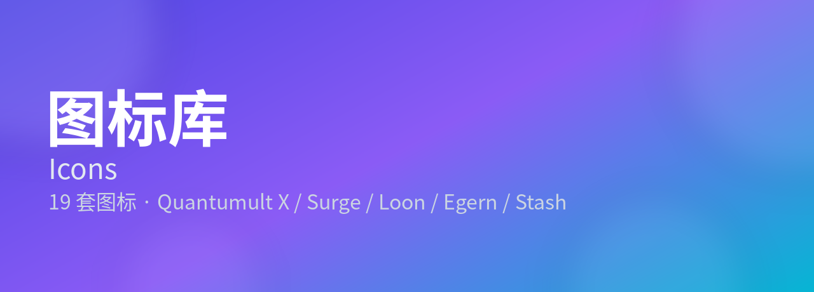

[English](README_EN.md) · [简体中文](README.md) · 日本語 · [한국어](README_KO.md) · [Türkçe](README_TR.md)



# Scripting スクリプト

Scripting App 用スクリプト集。気に入ったスクリプトフォルダをダウンロードして、Scripting App にインポートするだけですぐに使えます。
<div align="center">


</div>

## 📊 データ統計

<div align="center">


</div>

## 🛠️ 技術スタック

<div align="center">


</div>

## 😄 今日の一言

<div align="center">


</div>

## 🎮 コントリビューショングラフ

<div align="center">

<picture>
  <source media="(prefers-color-scheme: dark)" srcset="https://contrib-rotate.lzr52o.workers.dev/rotate?theme=dark" />
  <source media="(prefers-color-scheme: light)" srcset="https://contrib-rotate.lzr52o.workers.dev/rotate?theme=light" />
  
</picture>

</div>


## 📖 使い方

このリポジトリは Scripting App 用のスクリプト集です。37 個のスクリプト、8 つのカテゴリ（壁紙、監視ツール、ウィジェット、生活チェックイン、効率化、プラグインストア、ツール、AI）があります。ほとんどはホーム画面ウィジェットで、インストールすれば iOS ホーム画面に情報を表示できます。アプリ内で開いて使うツール（GitHub 管理やアイコン整理など）もあります。

**必要なもの：**

- iPhone または iPad に [Scripting App](https://apps.apple.com/app/id6479691128) をインストール
- 一部のスクリプトは自分のアカウントやサービスが必要です。たとえば qBitHelper は自分のダウンローダーに接続し、SGCC は国家電網（State Grid）アカウントへのログイン、CF Usage は Cloudflare アカウント情報の入力が必要です。スクリプトを開いて案内に従って入力してください

**使い方（ステップバイステップ）：**

1. 上のリストから好きなスクリプトを選び、そのフォルダを開く
2. フォルダ全体をダウンロードする（中のファイルを1つずつダウンロードするか、リポジトリ全体を Clone / ZIP ダウンロードしてフォルダを取り出す）
3. Scripting App を開き、ダウンロードしたフォルダをインポートする
4. ホーム画面に置く場合：iOS ホーム画面の空白部分を長押し → 左上の `+` をタップ → Scripting を探す → 好きなウィジェットサイズを選ぶ → インポートしたスクリプトを選ぶ
5. 一部のスクリプトは初回起動時にパラメータ（サーバーアドレス、都市、アカウントなど）の入力を求めます。Scripting App でスクリプトを開き、案内に従って入力してください

> AI Usage のみ `.scripting` パッケージです（画像が多く 19 MB あります）。ダウンロード後、そのままインポートしてください。解凍は不要です。

**よくある質問：**

- **インポートしてもウィジェットが表示されない？** まず Scripting App でスクリプトを開き、正常に動作するか確認してください。動かない場合は、パラメータが未入力か、ネット接続が必要なスクリプトがそのときネットワークに繋がらなかった可能性が高いです。
- **画像がずっと読み込めない？** 壁紙ウィジェットの画像はオンラインの画像ギャラリーから取得しています。ネットワークが不安定だと読み込みが遅くなります。しばらく待つか、更新をタップしてもう一度試してください。
- **1つのスクリプトだけ欲しくて、リポジトリ全体はいらない？** `scripts/` 内の対応フォルダを開き、そのフォルダだけダウンロードしてください。
- **これらのスクリプトは誰が書いたの？** 壁紙ウィジェットは原作者のバージョンをベースに改変したものですが、それ以外はすべて各原作者のオリジナル版です。著作権は原作者に帰属し、本リポジトリは収集のみを目的としています。

## スクリプト一覧

### 壁紙

| スクリプト | 説明 | バージョン |
|---|---|---|
| [壁纸小组件](scripts/WallpaperWidget) | ACG 二次元壁紙ウィジェット：高画質な ACG 画像をランダムに表示、更新間隔のカスタマイズ、画像 ID の指定、iOS ウィジェット表示に対応 | v1.2.6 |

### 監視ツール

| スクリプト | 説明 | バージョン |
|---|---|---|
| [qBitHelper](scripts/qBitHelper) | qBittorrent / Transmission リモート監視：アップロード／ダウンロード速度、履歴データのグラフ、トレント数、3 サイズのウィジェット | v1.0.6 |
| [智慧交通](scripts/智慧交通) | 都市交通状況モニター：リアルタイムの渋滞指数、渋滞道路ランキング、朝夕のラッシュ予測、全国の都市切り替えに対応 | v1.0.0 |
| [Surge Metrics](scripts/Surge%20Metrics) | Surge iOS 実行指標ウィジェット：累計トラフィック、メモリ、DNS キャッシュ、インターフェース別トラフィックランキング | v1.1.1 |
| [流媒體解鎖檢測](scripts/流媒體解鎖檢測) | ストリーミング解除検出ウィジェット：ノードで Netflix、Disney+、YouTube、ChatGPT などが視聴できるかテスト | v1.1.0 |
| [Loon Panel](scripts/Loon%20Panel) | Loon パネルウィジェット：トラフィック、ノード速度測定、ストリーミング解除検出、ホーム画面からノードやモードを直接切り替え | v1.0.9 |

### ウィジェット

| スクリプト | 説明 | バージョン |
|---|---|---|
| [Calendar](scripts/Calendar) | カレンダーウィジェット：西暦・旧暦、祝日、3 サイズ | v1.3.0 |
| [Weibo](scripts/Weibo) | Weibo トレンド検索ウィジェット | v1.1.0 |
| [SGCC](scripts/SGCC) | 国家電網（网上国网）ウィジェット：電気料金残高、電力量、段階料金の進捗と使用量の棒グラフ | v1.0.1 |
| [App Store Region](scripts/App%20Store%20Region) | App Store リージョン管理ウィジェット、3 サイズ | v1.0.0 |
| [万年历](scripts/万年历) | 万年カレンダーウィジェット：西暦・旧暦、祝日、3 サイズ | v1.0.0 |
| [Colorful Clouds](scripts/Colorful%20Clouds) | 彩雲天気ウィジェットと天気通知 | — |

### 生活チェックイン

| スクリプト | 説明 | バージョン |
|---|---|---|
| [Live In Earnest](scripts/Live%20In%20Earnest) | 毎日のチェックイン、あなたがまだ生きている証拠 | v1.0.0 |
| [Itemory](scripts/Itemory) | 個人の持ち物アーカイブ：購入・修理・売却収支を記録、保有日数と 1 日あたりのコストを計算、注文スクリーンショットの画像認識で登録可能 | v1.0.0 |

### 効率化

| スクリプト | 説明 | バージョン |
|---|---|---|
| [RSS](scripts/RSS) | AI 要約対応の RSS リーダー | v1.0.0 |

### プラグインストア

| スクリプト | 説明 | バージョン |
|---|---|---|
| [Scripting Store](scripts/Scripting%20Store) | Scripting プラグインストアクライアント：Scripting プラグインの閲覧・検索・インストール | v2.0.2 |

### ツール

| スクリプト | 説明 | バージョン |
|---|---|---|
| [GitHub Toolkit](scripts/Github%20Toolkit) | GitHub 万能ツール：リポジトリ／Gist／Action の閲覧・編集、PR 差分、スター、Fork 同期 | v2.0 |
| [Github Repo](scripts/Github%20Repo) | GitHub リポジトリマネージャー：リポジトリ閲覧、スター、Fork 同期、PR 作成 | v3.0 |
| [GitHub Stars](scripts/GitHub%20Stars) | GitHub Stars とリポジトリ管理：スターした日時順に閲覧、カスタムリスト、Fork 上流チェック、コントリビューションヒートマップ | v1.1.1 |
| [GitHub 規則添加](scripts/GitHub%20規則添加) | GitHub リポジトリにルールファイルをすばやく追加する小ツール | v2.0.0 |
| [Icon Library](scripts/Icon%20Library) | GitHub 公開アイコンライブラリ管理：複数のアイコンライブラリ、アイコンのインポートと整理、購読、PNG エクスポート | v1.1.2 |
| [IconShelf](scripts/IconShelf) | アイコンセット購読管理：プロキシアプリ・Emby などのアイコンセット、グループ化・検索・更新・バックアップと復元 | v0.4.0 |
| [Launch](scripts/Launch) | マルチウィジェットランチャー：フォルダ適応型、1 つの入口で複数のウィジェット設定を管理 | v1.15.2 |
| [覆写模块聚合](scripts/覆写模块聚合) | Surge / Loon / Egern / Stash / Shadowrocket のモジュール・プラグイン・上書き集約ディレクトリ、検索・お気に入り・ワンタップインポート | v1.1.0 |
| [CF Usage](scripts/CF%20Usage) | Cloudflare アカウントと各 Worker の使用量を確認、制限に近づいたら通知 | v1.0.0 |
| [GitHub Secrets](scripts/GitHub%20Secrets) | GitHub リポジトリの Secrets を管理、暗号化保存と複数リポジトリでの共有に対応 | v1.0.0 |
| [Storefront](scripts/Storefront) | 複数地域の Apple アカウントの残高・サブスクリプション・TestFlight 枠を管理 | v1.5.0 |
| [Remove Background](scripts/Remove%20Background) | 画像の背景をワンタップで除去（切り抜き） | v0.1.0 |
| [Cloudflare Panel](scripts/Cloudflare%20Panel) | Cloudflare パネル：アカウント使用量と Worker の状態、ホーム画面ウィジェット付き | — |
| [App多区价格查询](scripts/App多区价格查询) | 各地域の App Store でのアプリ価格を調べる | v1.0.0 |
| [Iconset Helper](scripts/Iconset%20Helper) | アイコンセットアシスタント：アイコンセットの整理とアップロード | v1.0.0 |
| [Gist](scripts/Gist) | GitHub Gist 管理：新規作成・編集・閲覧 | v1.0.0 |
| [Video to Live Photo](scripts/Video%20to%20Live%20Photo) | 動画・カバーフレーム・長さを選んで Live Photo として保存 | v1.0.0 |
| [Border Beam](scripts/Border%20Beam) | 枠の流光アニメーションデモ（Metal シェーダー）、UI コンポーネントの参考に | v1.0.0 |

### AI

| スクリプト | 説明 | バージョン |
|---|---|---|
| [AI Usage](scripts/AI%20Usage) | マルチプラットフォーム AI 使用量ダッシュボード：Codex、Grok、Claude、Cursor、Kimi など 11 プラットフォーム・複数アカウントの使用量、ホーム画面ウィジェット | v1.9.0 |
| [寒霜注入工具 2](scripts/寒霜注入工具%202) | ローカル AI プロキシゲートウェイ：iOS ネイティブ TCP 真ストリーミング、バックグラウンド維持、マルチエンジン冗長化 | v1.2.4 |
| [Codex Panel](scripts/Codex%20Panel) | Codex 使用量パネルウィジェット | — |

## 壁纸小组件

美しい ACG（アニメ）壁紙ウィジェットで、iOS ホーム画面を二次元スタイルで彩ります。

**主な機能：**

- 高画質な ACG 画像をランダムに表示
- 更新間隔をカスタマイズ可能
- 特定の画像 ID を指定可能
- iOS ウィジェット表示に対応
- 9 つの UI テーマ（少女ピンク／フレッシュグリーン／スカイブルー／ドリームパープル／エナジーオレンジ／パッションレッド／ミント／サニーイエロー／レインボーフロー）、レインボーテーマは 1.5 秒ごとに色が流れる
- iOS 26 リキッドガラス UI、背景はテーマカラーに連動する流光グラデーション

**本版の変更点（原作者 v1.0.3 ベース）：**

- 画像読み込み失敗を修正：API が返す無効リンク（404）は自動で次の画像に切り替え、最大 5 枚まで連続で試行。メインソースがすべて失敗した場合はバックアップの直リンク画像ソース（dmoe.cc、t.mwm.moe）を固定順で試行
- 読み込みタイムアウトを 8 秒から 30 秒に延長、メインソース失敗時は 3 回リトライ
- 9 つの UI テーマと流光グラデーション背景を追加、設定ページを iOS 26 ネイティブのリキッドガラスに刷新

原作者：[MolTau9527](https://github.com/MolTau9527)（[Scripting-Tools](https://github.com/MolTau9527/Scripting-Tools)、MIT ライセンス）

## qBitHelper

qBittorrent または Transmission ダウンローダーをリモート監視し、ダウンロードの進捗をいつでも把握できます。

**主な機能：**

- アップロード／ダウンロード速度の表示
- 履歴データのグラフ表示
- トレント数の統計
- qBittorrent と Transmission の両方に対応
- 3 サイズのウィジェット（小／中／大）
- App Intent でクライアントをすばやく切り替え
- クライアントごとに設定を個別保存

## 智慧交通

都市の交通状況をリアルタイムで確認できるホーム画面ウィジェット。出かける前に道路状況をチェックできます。

**主な機能：**

- 都市の交通渋滞指数をリアルタイム表示
- 渋滞レベルを可視化（スムーズ／やや渋滞／渋滞／激しい渋滞）
- 渋滞道路ランキング表示
- 朝夕ラッシュの渋滞予測
- 全国の都市切り替えに対応

**データ提供：** 百度交通指数

## Live In Earnest

毎日のチェックイン、あなたがまだ生きている証拠。

## Scripting Store

アプリ内で Scripting プラグインを直接閲覧・検索・インストールできる便利なプラグインストアクライアント。

**主な機能：**

- プラグイン一覧を閲覧
- プラグインを検索（名前／説明）
- プラグイン詳細を表示
- ワンタップでインストール
- 時間／人気順で並べ替え
- 自分のプラグインを公開
- パーソナルセンター管理

> **声明：** 本スクリプトはアプリへの適合のみを目的とし、ウェブサイトにはアクセスしません。Web サービスを提供してくださった原作者 [gallery.scripting.fun](https://gallery.scripting.fun) に感謝します。すべてのコンポーネントはインターネットから収集したもので、著作権は原作者に帰属します。

## インストール方法

1. iOS デバイスに [Scripting App](https://apps.apple.com/app/id6479691128) をインストールする
2. 欲しいスクリプトフォルダをダウンロードする（例：`scripts/WallpaperWidget`）
3. Scripting App にインポートする
4. 必要に応じてスクリプトのパラメータを設定する

## ディレクトリ構成

```
scripts/
├── WallpaperWidget/          # ACG 壁纸小组件
├── qBitHelper/               # qBittorrent/Transmission 远程监控
├── 智慧交通/                  # 城市交通状况监控
├── Surge Metrics/            # Surge 运行指标小组件
├── 流媒體解鎖檢測/            # 流媒体解锁检测
├── Loon Panel/               # Loon 面板小组件
├── Calendar/                 # 日历小组件
├── Weibo/                    # 微博热搜小组件
├── SGCC/                     # 网上国网小组件
├── App Store Region/         # App Store 地区管理
├── 万年历/                    # 万年历小组件
├── Colorful Clouds/          # 彩云天气小组件
├── Live In Earnest/          # 每日打卡
├── Itemory/                  # 个人物品档案
├── RSS/                      # RSS 阅读器
├── Scripting Store/          # 插件商店
├── Github Toolkit/           # GitHub 全能工具
├── Github Repo/              # GitHub 仓库管理器
├── GitHub Stars/             # GitHub Stars 与仓库管理
├── GitHub 規則添加/           # GitHub 仓库规则添加
├── Icon Library/             # GitHub 图标库管理
├── IconShelf/                # 图标集订阅管理
├── Launch/                   # 多小组件启动器
├── 覆写模块聚合/              # 代理模块与覆写聚合目录
├── CF Usage/                 # Cloudflare 用量查看
├── GitHub Secrets/           # GitHub Secrets 管理
├── Storefront/               # 多区 Apple 账号管理
├── Remove Background/        # 图片去背景
├── Cloudflare Panel/         # Cloudflare 面板
├── App多区价格查询/           # App 各区价格查询
├── Iconset Helper/           # 图标集助手
├── Gist/                     # GitHub Gist 管理
├── Video to Live Photo/      # 视频转 Live Photo
├── Border Beam/              # 边框流光动效演示
├── AI Usage/                 # 多平台 AI 用量看板（.scripting 包）
├── 寒霜注入工具 2/            # 本地 AI 代理网关
└── Codex Panel/              # Codex 用量面板
```

各スクリプトフォルダには完全なソースコード（script.json、index.tsx、widget.tsx、utils など）が入っており、ダウンロードして Scripting App にインポートすればすぐに使えます。AI Usage は画像リソースを大量に含む（19 MB）ため、オリジナルの .scripting パッケージ形式で収録しています。ダウンロードしてそのままインポートしてください。

## 説明

- 壁紙ウィジェット（MolTau9527 の v1.0.3 をベースに改変した v1.2.6）以外は、すべて各原作者のオリジナル版をそのまま収録しています。著作権は原作者に帰属し、本リポジトリは収集のみを目的としています。
- 画像の提供元は ACG 画像ギャラリー（loliapi.com）で、著作権は原作者に帰属します。

---

## 🙏 謝辞

本リポジトリに収録されているスクリプトとモジュールは、以下の原作者によるものです。ご尽力に感謝します：

[Jackie（Honye）](https://github.com/Honye)、[StarYunLee](https://github.com/StarYunLee)、[MolTau9527](https://github.com/MolTau9527)、[Kristen（iam-Kristen）](https://github.com/iam-Kristen)、001（001ProMax）、sssLucasss、CookiePie、MaYIHEI、thomfang、vcncv、xcheam、Scripting Agent、[ScriptingApp](https://github.com/ScriptingApp)

## ⚠️ 免責事項

本リポジトリは個人の学習用です。すべてのスクリプトとモジュールの著作権は原作者に帰属します。転載、ミラー、再配布、商用は禁止です。原作者の情報を削除しないでください。侵害がある場合は Telegram ボット [@ccccccccoBot](https://t.me/ccccccccoBot) までご連絡いただければ削除します。


