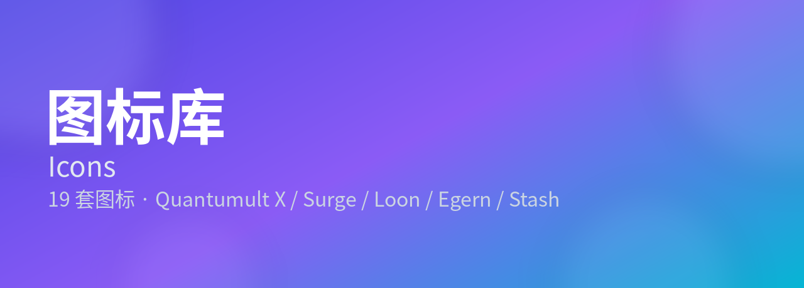

[English](README_EN.md) · [简体中文](README.md) · [日本語](README_JA.md) · 한국어 · [Türkçe](README_TR.md)



# Scripting 스크립트

Scripting App용 스크립트 모음집입니다. 마음에 드는 스크립트 폴더를 다운로드해 Scripting App으로 가져오기만 하면 바로 사용할 수 있습니다.
<div align="center">


</div>

## 📊 데이터 통계

<div align="center">


</div>

## 🛠️ 기술 스택

<div align="center">


</div>

## 😄 오늘의 한마디

<div align="center">


</div>

## 🎮 기여 그래프

<div align="center">

<picture>
  <source media="(prefers-color-scheme: dark)" srcset="https://contrib-rotate.lzr52o.workers.dev/rotate?theme=dark" />
  <source media="(prefers-color-scheme: light)" srcset="https://contrib-rotate.lzr52o.workers.dev/rotate?theme=light" />
  
</picture>

</div>


## 📖 사용 방법

이 저장소는 Scripting App용 스크립트 모음집으로, 총 37개의 스크립트를 8개 카테고리(벽지, 모니터링 도구, 위젯, 생활 기록, 생산성, 플러그인 스토어, 도구, AI)로 나누어 담았습니다. 대부분은 iOS 홈 화면에 정보를 보여주는 데스크톱 위젯이고, GitHub 관리나 아이콘 정리처럼 앱 안에서 열어 쓰는 도구도 있습니다.

**필요한 것:**

- [Scripting App](https://apps.apple.com/app/id6479691128)이 설치된 iPhone 또는 iPad
- 일부 스크립트는 본인의 계정이나 서비스가 필요합니다. 예를 들어 qBitHelper는 본인의 다운로더에 연결해야 하고, SGCC는 국가전망(网上国网) 계정, CF Usage는 Cloudflare 계정 정보가 필요합니다. 스크립트의 안내에 따라 입력하면 됩니다

**사용 방법(단계별):**

1. 위 목록에서 마음에 드는 스크립트를 골라 폴더를 엽니다
2. 폴더 전체를 다운로드합니다(파일을 하나씩 받거나, 저장소 전체를 Clone / ZIP으로 받아 필요한 폴더만 꺼내면 됩니다)
3. Scripting App을 열고 다운로드한 폴더를 가져옵니다
4. 홈 화면에 놓으려면: iOS 홈 화면의 빈 곳을 길게 누르기 → 왼쪽 위 `+` 누르기 → Scripting 찾기 → 위젯 크기 선택 → 방금 가져온 스크립트 선택
5. 처음 열 때 설정을 물어보는 스크립트도 있습니다(서버 주소, 도시, 계정 등). Scripting App에서 스크립트를 열고 안내에 따라 입력하세요

> `.scripting` 패키지인 것은 AI Usage뿐입니다(이미지가 많아 19 MB입니다). 다운로드해서 그대로 가져오면 됩니다. 압축을 풀 필요가 없습니다.

**자주 묻는 질문:**

- **가져왔는데 위젯이 안 보여요?** 먼저 Scripting App에서 스크립트를 열어 정상적으로 실행되는지 확인하세요. 안 되면 설정이 비어 있거나, 인터넷이 필요한 스크립트가 네트워크에 연결되지 못한 경우가 대부분입니다.
- **이미지가 계속 안 불러와져요?** 벽지 위젯의 이미지는 온라인 이미지 갤러리에서 가져옵니다. 네트워크가 느리면 로딩이 오래 걸리니, 잠시 기다리거나 새로고침을 눌러 다시 시도해 보세요.
- **저장소 전체가 아니라 스크립트 하나만 받고 싶어요?** `scripts/` 안의 해당 폴더를 열어 그 폴더만 다운로드하세요.
- **이 스크립트들은 누가 만든 건가요?** 벽지 위젯은 원작자 버전을 수정한 것이고, 나머지는 모두 원작자의 원본 그대로입니다. 저작권은 각 원작자에게 있으며, 이 저장소는 수집만 합니다.

## 스크립트 목록

### 배경화면

| 스크립트 | 설명 | 버전 |
|---|---|---|
| [壁纸小组件](scripts/WallpaperWidget) | ACG 애니메이션 배경화면 위젯: 고화질 ACG 이미지를 무작위로 표시, 새로고침 간격 설정, 이미지 ID 지정, iOS 위젯 표시 지원 | v1.2.6 |

### 모니터링 도구

| 스크립트 | 설명 | 버전 |
|---|---|---|
| [qBitHelper](scripts/qBitHelper) | qBittorrent / Transmission 원격 모니터링: 업로드·다운로드 속도, 기록 데이터 차트, 토렌트 수, 세 가지 위젯 크기 | v1.0.6 |
| [智慧交通](scripts/智慧交通) | 도시 교통 상황 모니터링: 실시간 정체 지수, 정체 도로 순위, 출퇴근 시간대 정체 예측, 전국 여러 도시 전환 지원 | v1.0.0 |
| [Surge Metrics](scripts/Surge%20Metrics) | Surge iOS 실행 지표 위젯: 누적 트래픽, 메모리, DNS 캐시, 인터페이스별 트래픽 순위 | v1.1.1 |
| [流媒體解鎖檢測](scripts/流媒體解鎖檢測) | 스트리밍 잠금 해제 감지 위젯: 노드로 Netflix, Disney+, YouTube, ChatGPT 등을 시청할 수 있는지 테스트 | v1.1.0 |
| [Loon Panel](scripts/Loon%20Panel) | Loon 패널 위젯: 트래픽, 노드 속도 측정, 스트리밍 잠금 해제, 홈 화면에서 바로 노드 전환 및 모드 변경 | v1.0.9 |

### 위젯

| 스크립트 | 설명 | 버전 |
|---|---|---|
| [Calendar](scripts/Calendar) | 캘린더 위젯: 양력·음력, 공휴일, 세 가지 크기 | v1.3.0 |
| [Weibo](scripts/Weibo) | 웨이보 실시간 검색어 위젯 | v1.1.0 |
| [SGCC](scripts/SGCC) | 국가전력망(网上国网) 위젯: 전기요금 잔액, 사용량, 누진 단계 진행률 및 사용량 막대 차트 | v1.0.1 |
| [App Store Region](scripts/App%20Store%20Region) | App Store 지역 관리 위젯, 세 가지 크기 | v1.0.0 |
| [万年历](scripts/万年历) | 만년력 위젯: 양력·음력, 공휴일, 세 가지 크기 | v1.0.0 |
| [Colorful Clouds](scripts/Colorful%20Clouds) | 차이윈 날씨 위젯 및 날씨 알림 | — |

### 생활 체크인

| 스크립트 | 설명 | 버전 |
|---|---|---|
| [Live In Earnest](scripts/Live%20In%20Earnest) | 매일 체크인, 당신이 아직 살아 있다는 증거 | v1.0.0 |
| [Itemory](scripts/Itemory) | 개인 물품 아카이브: 구매·수리·판매 내역 기록, 보유 일수 및 일평균 비용 계산, 주문 스크린샷 인식으로 입력 지원 | v1.0.0 |

### 효율성

| 스크립트 | 설명 | 버전 |
|---|---|---|
| [RSS](scripts/RSS) | AI 요약 지원 RSS 리더 | v1.0.0 |

### 플러그인 스토어

| 스크립트 | 설명 | 버전 |
|---|---|---|
| [Scripting Store](scripts/Scripting%20Store) | Scripting 플러그인 스토어 클라이언트: Scripting 플러그인 둘러보기, 검색, 설치 | v2.0.2 |

### 도구

| 스크립트 | 설명 | 버전 |
|---|---|---|
| [GitHub Toolkit](scripts/Github%20Toolkit) | GitHub 올인원 도구: 저장소/Gist/Action 둘러보기 및 편집, PR 차이, 스타, Fork 동기화 | v2.0 |
| [Github Repo](scripts/Github%20Repo) | GitHub 저장소 관리자: 저장소 둘러보기, 스타, Fork 동기화, PR 생성 | v3.0 |
| [GitHub Stars](scripts/GitHub%20Stars) | GitHub Stars 및 저장소 관리: 스타한 날짜순 둘러보기, 맞춤 목록, Fork 업스트림 확인, 기여 히트맵 | v1.1.1 |
| [GitHub 規則添加](scripts/GitHub%20規則添加) | GitHub 저장소에 규칙 파일을 빠르게 추가하는 작은 도구 | v2.0.0 |
| [Icon Library](scripts/Icon%20Library) | GitHub 공개 아이콘 라이브러리 관리: 여러 아이콘 라이브러리, 아이콘 가져오기 및 정리, 구독, PNG 내보내기 | v1.1.2 |
| [IconShelf](scripts/IconShelf) | 아이콘 세트 구독 관리: 프록시 앱, Emby 등 장면의 아이콘 세트, 그룹화·검색·업데이트·백업 및 복원 | v0.4.0 |
| [Launch](scripts/Launch) | 멀티 위젯 런처: 폴더 적응형, 하나의 입구로 여러 위젯 설정 관리 | v1.15.2 |
| [覆写模块聚合](scripts/覆写模块聚合) | Surge / Loon / Egern / Stash / Shadowrocket 모듈·플러그인·오버라이드 통합 디렉터리, 검색·즐겨찾기·원탭 가져오기 | v1.1.0 |
| [CF Usage](scripts/CF%20Usage) | Cloudflare 계정 및 개별 Worker 사용량 확인, 한도에 가까워지면 알림 | v1.0.0 |
| [GitHub Secrets](scripts/GitHub%20Secrets) | GitHub 저장소 Secrets 관리, 암호화 저장 및 여러 저장소 공유 지원 | v1.0.0 |
| [Storefront](scripts/Storefront) | 여러 지역 Apple 계정의 잔액·구독·TestFlight 자리 관리 | v1.5.0 |
| [Remove Background](scripts/Remove%20Background) | 이미지 배경 원탭 제거(누끼) | v0.1.0 |
| [Cloudflare Panel](scripts/Cloudflare%20Panel) | Cloudflare 패널: 계정 사용량, Worker 상태, 홈 화면 위젯 포함 | — |
| [App多区价格查询](scripts/App多区价格查询) | 앱의 각 지역 App Store 가격 조회 | v1.0.0 |
| [Iconset Helper](scripts/Iconset%20Helper) | 아이콘 세트 도우미: 아이콘 세트 정리 및 업로드 | v1.0.0 |
| [Gist](scripts/Gist) | GitHub Gist 관리: 새로 만들기, 편집, 보기 | v1.0.0 |
| [Video to Live Photo](scripts/Video%20to%20Live%20Photo) | 동영상·표지 프레임·길이를 선택해 Live Photo로 저장 | v1.0.0 |
| [Border Beam](scripts/Border%20Beam) | 테두리 빛 흐름 애니메이션 데모(Metal 셰이더), UI 컴포넌트 참고용 | v1.0.0 |

### AI

| 스크립트 | 설명 | 버전 |
|---|---|---|
| [AI Usage](scripts/AI%20Usage) | 멀티 플랫폼 AI 사용량 통합 대시보드: Codex, Grok, Claude, Cursor, Kimi 등 11개 플랫폼·다중 계정 사용량, 홈 화면 위젯 | v1.9.0 |
| [寒霜注入工具 2](scripts/寒霜注入工具%202) | 로컬 AI 프록시 게이트웨이: iOS 네이티브 TCP 진짜 스트리밍, 백그라운드 유지, 멀티 엔진 장애 조치 | v1.2.4 |
| [Codex Panel](scripts/Codex%20Panel) | Codex 사용량 패널 위젯 | — |

## 壁纸小组件

아름다운 ACG(애니메이션) 배경화면 위젯으로 iOS 홈 화면을 애니메이션 스타일로 가득 채워 줍니다.

**주요 기능:**

- 고화질 ACG 이미지 무작위 표시
- 새로고침 간격 설정 가능
- 특정 이미지 ID 지정 가능
- iOS 위젯 표시 지원
- 9가지 UI 테마(소녀 핑크 / 프레시 그린 / 스카이 블루 / 드림 퍼플 / 에너지 오렌지 / 패션 레드 / 민트 / 써니 옐로우 / 레인보우 플로우), 레인보우 테마는 1.5초마다 색이 흐름
- iOS 26 리퀴드 글래스 UI, 테마 색상을 따라 흐르는 그라데이션 배경

**이번 버전 변경 사항(원작자 v1.0.3 기준):**

- 이미지 로딩 실패 수정: API가 반환하는 죽은 링크(404)는 자동으로 다음 이미지로 전환, 최대 5장까지 연속 시도. 메인 소스가 모두 실패하면 백업 직링크 이미지 소스(dmoe.cc, t.mwm.moe)를 고정 순서로 시도
- 로딩 제한 시간을 8초에서 30초로 연장, 메인 소스 실패 시 3회 재시도
- 9가지 UI 테마와 흐르는 그라데이션 배경 추가, 설정 페이지를 iOS 26 네이티브 리퀴드 글래스로 변경

원작자: [MolTau9527](https://github.com/MolTau9527)（[Scripting-Tools](https://github.com/MolTau9527/Scripting-Tools), MIT 라이선스)

## qBitHelper

qBittorrent 또는 Transmission 다운로더를 원격으로 모니터링하고 다운로드 진행 상황을 언제든 확인할 수 있습니다.

**주요 기능:**

- 업로드/다운로드 속도 표시
- 기록 데이터 차트 표시
- 토렌트 수 통계
- qBittorrent와 Transmission 동시 지원
- 세 가지 위젯 크기(소/중/대)
- App Intent로 클라이언트 빠르게 전환
- 클라이언트마다 설정 개별 저장

## 智慧交通

도시 교통 상황을 실시간으로 확인할 수 있는 홈 화면 위젯으로, 외출 전에 도로 상황을 파악할 수 있습니다.

**주요 기능:**

- 도시 교통 정체 지수 실시간 표시
- 정체 수준 시각화(원활/서행/정체/심각한 정체)
- 정체 도로 순위 표시
- 출퇴근 시간대 정체 예측
- 전국 여러 도시 전환 지원

**데이터 출처:** 바이두 교통 지수

## Live In Earnest

매일 체크인, 당신이 아직 살아 있다는 증거.

## Scripting Store

앱 안에서 Scripting 플러그인을 바로 둘러보고, 검색하고, 설치할 수 있는 편리한 플러그인 스토어 클라이언트입니다.

**주요 기능:**

- 플러그인 목록 둘러보기
- 플러그인 검색(이름/설명)
- 플러그인 상세 보기
- 원탭 설치
- 시간/인기순 정렬
- 자신의 플러그인 게시
- 개인 센터 관리

> **알림:** 이 스크립트는 앱 적용만을 위한 것으로, 웹사이트에 직접 접속하지 않습니다. 웹 서비스를 제공해 주신 원작자 [gallery.scripting.fun](https://gallery.scripting.fun)께 감사드립니다. 모든 구성 요소는 인터넷에서 수집한 것이며, 저작권은 원작자에게 있습니다.

## 설치 방법

1. iOS 기기에 [Scripting App](https://apps.apple.com/app/id6479691128) 설치
2. 원하는 스크립트 폴더 다운로드(예: `scripts/WallpaperWidget`)
3. Scripting App으로 가져오기
4. 필요에 따라 스크립트 매개변수 설정

## 디렉터리 구조

```
scripts/
├── WallpaperWidget/          # ACG 壁纸小组件
├── qBitHelper/               # qBittorrent/Transmission 远程监控
├── 智慧交通/                  # 城市交通状况监控
├── Surge Metrics/            # Surge 运行指标小组件
├── 流媒體解鎖檢測/            # 流媒体解锁检测
├── Loon Panel/               # Loon 面板小组件
├── Calendar/                 # 日历小组件
├── Weibo/                    # 微博热搜小组件
├── SGCC/                     # 网上国网小组件
├── App Store Region/         # App Store 地区管理
├── 万年历/                    # 万年历小组件
├── Colorful Clouds/          # 彩云天气小组件
├── Live In Earnest/          # 每日打卡
├── Itemory/                  # 个人物品档案
├── RSS/                      # RSS 阅读器
├── Scripting Store/          # 插件商店
├── Github Toolkit/           # GitHub 全能工具
├── Github Repo/              # GitHub 仓库管理器
├── GitHub Stars/             # GitHub Stars 与仓库管理
├── GitHub 規則添加/           # GitHub 仓库规则添加
├── Icon Library/             # GitHub 图标库管理
├── IconShelf/                # 图标集订阅管理
├── Launch/                   # 多小组件启动器
├── 覆写模块聚合/              # 代理模块与覆写聚合目录
├── CF Usage/                 # Cloudflare 用量查看
├── GitHub Secrets/           # GitHub Secrets 管理
├── Storefront/               # 多区 Apple 账号管理
├── Remove Background/        # 图片去背景
├── Cloudflare Panel/         # Cloudflare 面板
├── App多区价格查询/           # App 各区价格查询
├── Iconset Helper/           # 图标集助手
├── Gist/                     # GitHub Gist 管理
├── Video to Live Photo/      # 视频转 Live Photo
├── Border Beam/              # 边框流光动效演示
├── AI Usage/                 # 多平台 AI 用量看板（.scripting 包）
├── 寒霜注入工具 2/            # 本地 AI 代理网关
└── Codex Panel/              # Codex 用量面板
```

각 스크립트 폴더에는 완전한 소스 코드(script.json, index.tsx, widget.tsx, utils 등)가 들어 있어 다운로드 후 Scripting App으로 가져오면 바로 사용할 수 있습니다. AI Usage는 이미지 리소스가 많아(19 MB) 원본 .scripting 패키지 형태로 수록되어 있으며, 다운로드 후 바로 가져오면 됩니다.

## 참고

- 배경화면 위젯(MolTau9527의 v1.0.3을 바탕으로 수정한 v1.2.6)을 제외한 나머지 스크립트는 모두 각 원작자의 원본 그대로 수록했으며, 저작권은 원작자에게 있고 본 저장소는 수집만을 목적으로 합니다.
- 이미지 출처는 ACG 이미지 갤러리(loliapi.com)이며, 저작권은 원작자에게 있습니다.


