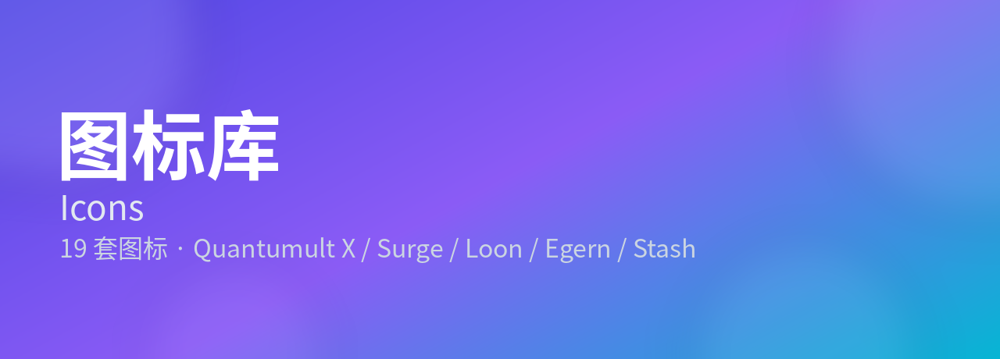

[English](README_EN.md) · [简体中文](README.md) · [日本語](README_JA.md) · [한국어](README_KO.md) · Türkçe



# Scripting Betikleri

Scripting App için betik koleksiyonu. Beğendiğiniz betik klasörünü indirip Scripting App'e aktarmanız yeterli.
<div align="center">


</div>

## 📊 Veri İstatistikleri

<div align="center">


</div>

## 🛠️ Teknoloji Yığını

<div align="center">


</div>

## 😄 Günün Sözü

<div align="center">


</div>

## 🎮 Katkı Grafiği

<div align="center">

<picture>
  <source media="(prefers-color-scheme: dark)" srcset="https://contrib-rotate.lzr52o.workers.dev/rotate?theme=dark" />
  <source media="(prefers-color-scheme: light)" srcset="https://contrib-rotate.lzr52o.workers.dev/rotate?theme=light" />
  
</picture>

</div>


## 📖 Kullanım Kılavuzu

Bu depo, Scripting App için hazırlanmış bir betik koleksiyonudur: toplam 37 betik, 8 kategori (Duvar Kağıdı, İzleme Araçları, Widget'lar, Günlük Check-in, Verimlilik, Eklenti Mağazası, Araçlar, Yapay Zekâ). Çoğu ana ekran widget'ıdır; kurduktan sonra bilgileri doğrudan iOS ana ekranınızda gösterir. Bazıları da uygulama içinde açıp kullandığınız araçlardır (GitHub yönetimi, simge düzenleme gibi).

**Neler gerekli:**

- [Scripting App](https://apps.apple.com/app/id6479691128) yüklü bir iPhone veya iPad
- Bazı betikler kendi hesabınızı veya hizmetinizi gerektirir; örneğin qBitHelper kendi indiricilerinize bağlanır, SGCC State Grid hesabıyla giriş ister, CF Usage Cloudflare hesap bilgilerinizi ister. Betiği açıp istendiği gibi doldurmanız yeterli

**Nasıl kullanılır (adım adım):**

1. Yukarıdaki listeden beğendiğiniz bir betiği seçip klasörünü açın
2. Klasörün tamamını indirin (içindeki dosyaları tek tek indirin ya da deponun tamamını Clone / ZIP olarak indirip klasörü çıkarın)
3. Scripting App'i açıp indirdiğiniz klasörü içe aktarın
4. Ana ekrana koymak için: iOS ana ekranında boş bir alana uzun basın → sol üstteki `+` simgesine dokunun → Scripting'i bulun → istediğiniz widget boyutunu seçin → az önce içe aktardığınız betiği seçin
5. Bazı betikler ilk açılışta parametre ister (sunucu adresi, şehir, hesap gibi); Scripting App içinde betiği açıp istendiği gibi doldurun

> Yalnızca AI Usage bir `.scripting` paketidir (çok fazla görsel içerdiği için 19 MB). İndirdikten sonra doğrudan içe aktarın, açmanıza gerek yok.

**Sık sorulan sorular:**

- **İçe aktardıktan sonra widget görünmüyor?** Önce Scripting App içinde betiği açıp düzgün çalışıp çalışmadığına bakın. Çalışmıyorsa büyük olasılıkla parametreler doldurulmamıştır ya da internet gerektiren betik o sırada ağa ulaşamamıştır.
- **Görseller bir türlü yüklenmiyor?** Duvar kağıdı widget'ının görselleri çevrimiçi galerilerden gelir. Bağlantı zayıfsa yükleme yavaş olur; biraz bekleyin ya da yenileye dokunup tekrar deneyin.
- **Deponun tamamını değil, yalnızca bir betik istiyorum?** `scripts/` içindeki ilgili klasörü açıp yalnızca o klasörü indirin.
- **Bu betikleri kim yazdı?** Duvar kağıdı widget'ı orijinal yazarın sürümünü temel alarak değiştirilmiştir; diğerlerinin tamamı ilgili orijinal yazarların orijinal sürümleridir. Telif hakkı orijinal yazarlara aittir; bu depo yalnızca bir koleksiyondur.

## Betik Listesi

### Duvar Kağıdı

| Betik | Açıklama | Sürüm |
|---|---|---|
| [壁纸小组件](scripts/WallpaperWidget) | ACG anime duvar kağıdı widget'ı: yüksek kaliteli ACG görsellerini rastgele gösterir, özel yenileme aralığı, belirli görsel kimliği seçimi ve iOS widget desteği | v1.2.6 |

### İzleme Araçları

| Betik | Açıklama | Sürüm |
|---|---|---|
| [qBitHelper](scripts/qBitHelper) | qBittorrent / Transmission uzaktan izleme: yükleme ve indirme hızları, geçmiş veri grafikleri, torrent sayısı, üç widget boyutu | v1.0.6 |
| [智慧交通](scripts/智慧交通) | Şehir trafik durumu izleme: gerçek zamanlı tıkanıklık endeksi, tıkanık yol sıralaması, sabah/akşam yoğun saat tahmini, ülke genelinde çok şehirli geçiş desteği | v1.0.0 |
| [Surge Metrics](scripts/Surge%20Metrics) | Surge iOS çalışma göstergeleri widget'ı: toplam trafik, bellek, DNS önbelleği, arayüz trafik sıralaması | v1.1.1 |
| [流媒體解鎖檢測](scripts/流媒體解鎖檢測) | Akış platformu kilit açma denetimi widget'ı: düğümün Netflix, Disney+, YouTube, ChatGPT vb. izleyip izleyemediğini test eder | v1.1.0 |
| [Loon Panel](scripts/Loon%20Panel) | Loon panel widget'ı: trafik, düğüm hız testi, akış kilit açma denetimi — ana ekrandan düğüm ve mod değiştirme | v1.0.9 |

### Widget'lar

| Betik | Açıklama | Sürüm |
|---|---|---|
| [Calendar](scripts/Calendar) | Takvim widget'ı: Miladi ve ay takvimi, tatiller, üç boyut | v1.3.0 |
| [Weibo](scripts/Weibo) | Weibo gündem widget'ı | v1.1.0 |
| [SGCC](scripts/SGCC) | Devlet Şebekesi (网上国网) widget'ı: elektrik bakiyesi, tüketim, kademeli tarife ilerlemesi ve tüketim çubuk grafiği | v1.0.1 |
| [App Store Region](scripts/App%20Store%20Region) | App Store bölge yönetimi widget'ı, üç boyut | v1.0.0 |
| [万年历](scripts/万年历) | Daimi takvim widget'ı: Miladi ve ay takvimi, tatiller, üç boyut | v1.0.0 |
| [Colorful Clouds](scripts/Colorful%20Clouds) | Caiyun hava durumu widget'ı ve hava durumu bildirimleri | — |

### Günlük Check-in

| Betik | Açıklama | Sürüm |
|---|---|---|
| [Live In Earnest](scripts/Live%20In%20Earnest) | Günlük check-in, hâlâ hayatta olduğunun kanıtı | v1.0.0 |
| [Itemory](scripts/Itemory) | Kişisel eşya arşivi: satın alma, onarım ve satış gelirlerini kaydet, sahip olunan gün sayısı ve günlük ortalama maliyeti hesapla, sipariş ekran görüntüsü tanımayla kayıt desteği | v1.0.0 |

### Verimlilik

| Betik | Açıklama | Sürüm |
|---|---|---|
| [RSS](scripts/RSS) | Yapay zekâ özetli RSS okuyucu | v1.0.0 |

### Eklenti Mağazası

| Betik | Açıklama | Sürüm |
|---|---|---|
| [Scripting Store](scripts/Scripting%20Store) | Scripting eklenti mağazası istemcisi: Scripting eklentilerine göz at, ara ve yükle | v2.0.2 |

### Araçlar

| Betik | Açıklama | Sürüm |
|---|---|---|
| [GitHub Toolkit](scripts/Github%20Toolkit) | GitHub çok amaçlı araç: depo/Gist/Action göz atma ve düzenleme, PR farkları, yıldızlar, Fork senkronizasyonu | v2.0 |
| [Github Repo](scripts/Github%20Repo) | GitHub depo yöneticisi: depolara göz at, yıldızla, Fork senkronize et, PR oluştur | v3.0 |
| [GitHub Stars](scripts/GitHub%20Stars) | GitHub Stars ve depo yönetimi: yıldızlama tarihine göre göz at, özel listeler, Fork kaynak denetimi, katkı ısı haritası | v1.1.1 |
| [GitHub 規則添加](scripts/GitHub%20規則添加) | GitHub deposuna kural dosyalarını hızla ekleyen küçük araç | v2.0.0 |
| [Icon Library](scripts/Icon%20Library) | Herkese açık GitHub simge kitaplığı yöneticisi: birden çok simge kitaplığı, simge içe aktarma ve düzenleme, abonelik ve PNG dışa aktarma | v1.1.2 |
| [IconShelf](scripts/IconShelf) | Simge seti abonelik yöneticisi: proxy uygulamaları, Emby vb. için simge setleri, gruplama, arama, güncelleme, yedekleme ve geri yükleme | v0.4.0 |
| [Launch](scripts/Launch) | Çoklu widget başlatıcı: klasöre uyumlu, tek girişten birden çok widget yapılandırması | v1.15.2 |
| [覆写模块聚合](scripts/覆写模块聚合) | Surge / Loon / Egern / Stash / Shadowrocket modül, eklenti ve geçersiz kılma toplu dizini; arama, favoriler ve tek dokunuşla içe aktarma | v1.1.0 |
| [CF Usage](scripts/CF%20Usage) | Cloudflare hesabı ve tekil Worker kullanımını görüntüle, kotaya yaklaşınca uyar | v1.0.0 |
| [GitHub Secrets](scripts/GitHub%20Secrets) | GitHub depo Secrets yönetimi, şifreli depolama ve çok depolu paylaşım desteği | v1.0.0 |
| [Storefront](scripts/Storefront) | Birden çok bölgedeki Apple hesaplarının bakiye, abonelik ve TestFlight kontenjanlarını yönet | v1.5.0 |
| [Remove Background](scripts/Remove%20Background) | Görsel arka planını tek dokunuşla kaldır | v0.1.0 |
| [Cloudflare Panel](scripts/Cloudflare%20Panel) | Cloudflare paneli: hesap kullanımı ve Worker durumu, ana ekran widget'ıyla | — |
| [App多区价格查询](scripts/App多区价格查询) | Uygulamanın farklı bölgelerdeki App Store fiyatlarını sorgula | v1.0.0 |
| [Iconset Helper](scripts/Iconset%20Helper) | Simge seti yardımcısı: simge setlerini düzenle ve yükle | v1.0.0 |
| [Gist](scripts/Gist) | GitHub Gist yönetimi: oluştur, düzenle, görüntüle | v1.0.0 |
| [Video to Live Photo](scripts/Video%20to%20Live%20Photo) | Video, kapak karesi ve süre seçip Live Photo olarak kaydet | v1.0.0 |
| [Border Beam](scripts/Border%20Beam) | Kenarlık ışık akışı animasyon demosu (Metal shader), kullanıcı arayüzü bileşeni referansı olarak kullanılabilir | v1.0.0 |

### AI

| Betik | Açıklama | Sürüm |
|---|---|---|
| [AI Usage](scripts/AI%20Usage) | Çok platformlu yapay zekâ kullanım panosu: Codex, Grok, Claude, Cursor, Kimi dahil 11 platformda çok hesaplı kullanım, ana ekran widget'ı | v1.9.0 |
| [寒霜注入工具 2](scripts/寒霜注入工具%202) | Yerel yapay zekâ proxy ağ geçidi: iOS yerel TCP gerçek akış, arka planda canlı tutma, çok motorlu yedeklilik | v1.2.4 |
| [Codex Panel](scripts/Codex%20Panel) | Codex kullanım paneli widget'ı | — |

## 壁纸小组件

iOS ana ekranınızı anime tarzıyla dolduran güzel bir ACG (anime) duvar kağıdı widget'ı.

**Temel özellikler:**

- Yüksek kaliteli ACG görsellerini rastgele göster
- Özel yenileme aralığı
- Belirli bir görsel kimliği seçilebilir
- iOS widget desteği
- 9 arayüz teması (Kız Pembesi / Ferah Yeşil / Gök Mavisi / Rüya Moru / Enerjik Turuncu / Tutku Kırmızısı / Nane / Güneş Sarısı / Gökkuşağı Akışı), gökkuşağı temasının renkleri her 1,5 saniyede akar
- iOS 26 Liquid Glass arayüzü, tema rengini izleyen akan gradyan arka plan

**Bu sürümdeki değişiklikler (orijinal yazarın v1.0.3 sürümünü temel alır):**

- Görsel yükleme hatası düzeltildi: API'nin döndürdüğü ölü bağlantılar (404) otomatik olarak sonraki görsele geçer, arka arkaya en fazla 5 görsel denenir; ana kaynak tamamen çökerse yedek doğrudan görsel kaynakları (dmoe.cc, t.mwm.moe) sabit sırayla denenir
- Yükleme zaman aşımı 8 saniyeden 30 saniyeye çıkarıldı, ana kaynak başarısız olursa 3 kez yeniden deneme
- 9 arayüz teması ve akan gradyan arka plan eklendi, ayarlar sayfası iOS 26 yerel Liquid Glass ile yenilendi

Orijinal yazar: [MolTau9527](https://github.com/MolTau9527) ([Scripting-Tools](https://github.com/MolTau9527/Scripting-Tools), MIT lisansı)

## qBitHelper

qBittorrent veya Transmission indiricinizin durumunu uzaktan izleyin ve indirme ilerlemesini her an takip edin.

**Temel özellikler:**

- Yükleme/indirme hızlarını göster
- Geçmiş veri grafiklerini göster
- Torrent sayısı istatistiği
- qBittorrent ve Transmission'ı aynı anda destekler
- Üç widget boyutunu destekler (küçük/orta/büyük)
- App Intent ile istemci arasında hızlı geçiş
- Her istemci yapılandırmasını ayrı kaydeder

## 智慧交通

Şehir trafik durumunu gerçek zamanlı gösteren ana ekran widget'ı; yola çıkmadan önce yol durumunu öğrenmenizi sağlar.

**Temel özellikler:**

- Şehir trafik tıkanıklık endeksini gerçek zamanlı göster
- Tıkanıklık seviyesini görselleştir (akıcı/yavaş/tıkanık/ağır tıkanık)
- Tıkanık yol sıralamasını göster
- Sabah/akşam yoğun saat tıkanıklık tahmini
- Ülke genelinde çok şehirli geçiş desteği

**Veri kaynağı:** Baidu Trafik Endeksi

## Live In Earnest

Günlük check-in, hâlâ hayatta olduğunun kanıtı.

## Scripting Store

Uygulama içinden Scripting eklentilerine göz atıp arayabileceğiniz ve yükleyebileceğiniz kullanışlı bir eklenti mağazası istemcisi.

**Temel özellikler:**

- Eklenti listesine göz at
- Eklentileri ara (ada/açıklamaya göre)
- Eklenti ayrıntılarını görüntüle
- Tek dokunuşla eklenti yükle
- Zamana/popülerliğe göre sırala
- Kendi eklentini yayınla
- Kişisel merkez yönetimi

> **Bildirim:** Bu betik yalnızca uygulamaya uyarlama amaçlıdır ve web sitesine erişmez. Web hizmetini sağlayan orijinal yazar [gallery.scripting.fun](https://gallery.scripting.fun)'a teşekkürler. Tüm bileşenler internetten toplanmıştır; telif hakları orijinal yazarlara aittir.

## Kurulum

1. iOS cihazınıza [Scripting App](https://apps.apple.com/app/id6479691128) yükleyin
2. İstediğiniz betik klasörünü indirin (ör. `scripts/WallpaperWidget`)
3. Scripting App'e aktarın
4. Gerektiğinde betik parametrelerini yapılandırın

## Dizin Yapısı

```
scripts/
├── WallpaperWidget/          # ACG 壁纸小组件
├── qBitHelper/               # qBittorrent/Transmission 远程监控
├── 智慧交通/                  # 城市交通状况监控
├── Surge Metrics/            # Surge 运行指标小组件
├── 流媒體解鎖檢測/            # 流媒体解锁检测
├── Loon Panel/               # Loon 面板小组件
├── Calendar/                 # 日历小组件
├── Weibo/                    # 微博热搜小组件
├── SGCC/                     # 网上国网小组件
├── App Store Region/         # App Store 地区管理
├── 万年历/                    # 万年历小组件
├── Colorful Clouds/          # 彩云天气小组件
├── Live In Earnest/          # 每日打卡
├── Itemory/                  # 个人物品档案
├── RSS/                      # RSS 阅读器
├── Scripting Store/          # 插件商店
├── Github Toolkit/           # GitHub 全能工具
├── Github Repo/              # GitHub 仓库管理器
├── GitHub Stars/             # GitHub Stars 与仓库管理
├── GitHub 規則添加/           # GitHub 仓库规则添加
├── Icon Library/             # GitHub 图标库管理
├── IconShelf/                # 图标集订阅管理
├── Launch/                   # 多小组件启动器
├── 覆写模块聚合/              # 代理模块与覆写聚合目录
├── CF Usage/                 # Cloudflare 用量查看
├── GitHub Secrets/           # GitHub Secrets 管理
├── Storefront/               # 多区 Apple 账号管理
├── Remove Background/        # 图片去背景
├── Cloudflare Panel/         # Cloudflare 面板
├── App多区价格查询/           # App 各区价格查询
├── Iconset Helper/           # 图标集助手
├── Gist/                     # GitHub Gist 管理
├── Video to Live Photo/      # 视频转 Live Photo
├── Border Beam/              # 边框流光动效演示
├── AI Usage/                 # 多平台 AI 用量看板（.scripting 包）
├── 寒霜注入工具 2/            # 本地 AI 代理网关
└── Codex Panel/              # Codex 用量面板
```

Her betik klasörü tam kaynak kodu içerir (script.json, index.tsx, widget.tsx, utils vb.); indirip Scripting App'e aktarınca hemen kullanılabilir. AI Usage çok sayıda görsel kaynak içerdiğinden (19 MB) orijinal .scripting paketi olarak eklenmiştir; indirip doğrudan aktarmanız yeterli.

## Açıklama

- Duvar kağıdı widget'ı (MolTau9527'nin v1.0.3 sürümünü temel alan değiştirilmiş v1.2.6 sürümü) dışında diğer tüm betikler ilgili orijinal yazarların orijinal sürümleriyle eklenmiştir; telif hakları orijinal yazarlara aittir, bu depo yalnızca bir koleksiyondur.
- Görsel kaynakları ACG görsel galerisidir (loliapi.com); telif hakları orijinal yazarlara aittir.

---

## 🙏 Teşekkürler

Bu depodaki tüm komut dosyaları ve modüller aşağıdaki orijinal yazarlara aittir. Emekleriniz için teşekkürler：

[Jackie（Honye）](https://github.com/Honye)、[StarYunLee](https://github.com/StarYunLee)、[MolTau9527](https://github.com/MolTau9527)、[Kristen（iam-Kristen）](https://github.com/iam-Kristen)、001（001ProMax）、sssLucasss、CookiePie、MaYIHEI、thomfang、vcncv、xcheam、Scripting Agent、[ScriptingApp](https://github.com/ScriptingApp)

## ⚠️ Sorumluluk Reddi

Bu depo yalnızca kişisel öğrenim içindir. Tüm komut dosyalarının ve modüllerin telif hakkı orijinal yazarlara aittir. Yeniden yayınlama, yansıtma, yeniden dağıtım ve ticari kullanım yasaktır. Orijinal yazar bilgilerini kaldırmayın. Herhangi bir ihlal varsa Telegram botum [@ccccccccoBot](https://t.me/ccccccccoBot) ile iletişime geçin, kaldıralım.


